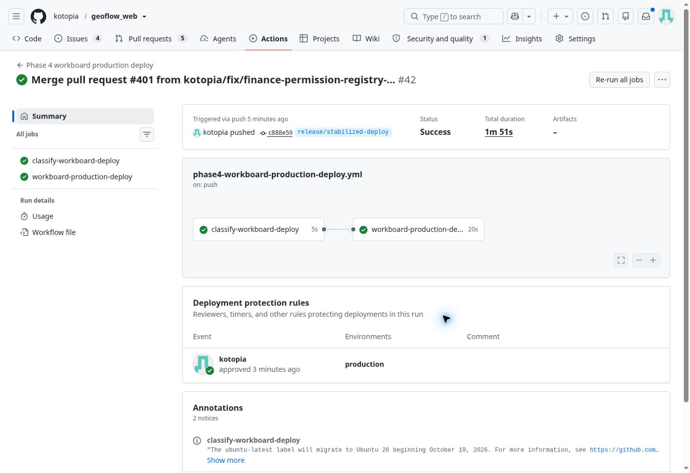

# Finance 권한 분리 — 구현 및 운영 적용

기준: `release/stabilized-deploy` @ `b1ae3e8fc4d3f2f276421790b2d138e6d4c41f5b`.

## 범위

이벤트 UI·저장 테이블과 Finance 원장을 유지한다. 중앙 로그인, 테넌트 연결,
GIS/QGIS/QField, 계약·프로젝트 일반 CRUD는 변경하지 않는다. 테넌트 migration,
새 테이블/컬럼, Finance→이벤트 데이터 복제는 없다.

## 권한

| 대상 | 조회 | 변경 |
|---|---|---|
| Finance 메뉴·원장·요약·증빙 | finance.view | finance.view + finance.edit |
| 기존 계약/프로젝트 정산 이벤트 | 대상 조회 권한 + finance.view | 대상 편집 권한 + finance.view + finance.edit |
| Finance 영구삭제 | — | 위 편집 권한 + tenant_admin |

계약 권한이나 관리자 역할만으로 재무 권한을 추론하지 않는다.
권한이 누락되면 접근을 거부한다. finance.edit 단독도 읽기/쓰기 권한이 아니다.
계약/프로젝트 화면 자체의 접근 권한과 프로젝트 참여자 범위는 유지한다.

## 이벤트 및 첨부

- 현재 settlement 단계와 역사적 billing/blilling 단계를 재무로 분류한다.
- 알려진 선금/기성금/준공금, invoice/tax_invoice/progress_invoice/payment 유형은
  다른 단계로 옮겨도 재무 권한을 요구한다. 사용자 정의 settlement 유형도 보호한다.
- 생성/수정 시 새 분류, 수정/삭제/첨부 시 저장된 분류를 검사한다.
- 통합 타임라인은 연결된 이벤트 각각의 조회 권한을 검사한 뒤 첨부/담당자 정보를 조회한다.
- 캘린더, 목록 배지, 업무단계 요약에서도 재무 이벤트 표시를 제한한다.
- Finance 증빙은 계약/orgunit 아래 저장되더라도 purpose/meta로 식별하여
  일반 파일 다운로드/미리보기/삭제 URL에서 계약 권한으로 우회하지 못하게 한다.
- 기술 업무단계 계산은 Finance 표시 권한과 무관하게 기존 방식으로 유지한다.
- Finance 원장 통합 타임라인 조회는 기존 미구현 후속 항목으로 남는다.

## 중앙 설정 및 적용 순서

중앙의 기존 permissions와 role_permissions를 사용한다. 새 권한 테이블이나
인증/미들웨어 변경은 없다. 역할 매핑은 전역이므로 같은 역할을 사용하는 모든
테넌트에 적용된다. 사용자 역할이나 기존 계약/프로젝트 권한은 이 명령이 변경하지 않는다.

1. 재무 조회 역할과 편집 역할의 정확한 목록을 확정한다. 자동 기본 부여는 없다.
2. 중앙 설정이 있는 승인된 런타임에서 아래 명령으로 SELECT-only 계획을 확인한다.
3. 승인된 역할 목록에 대해서만 --apply를 실행한다. 편집 역할에는 조회도 함께 부여된다.
4. 중앙 설정을 확인한 뒤 코드 배포/서비스 재시작을 운영 승인 범위에서 수행한다.
5. 조회 전용, 편집 가능, 재무 접근 불가 계정으로 Finance·이벤트·증빙·캘린더를 검증한다.

2026-10-13 사용자가 승인하고 운영에 적용한 초기 역할:

```sh
python manage.py provision_finance_permissions --edit-role tenant_admin --edit-role manager
# 위 출력의 기존 매핑과 신규 추가를 확인한 뒤:
python manage.py provision_finance_permissions --edit-role tenant_admin --edit-role manager --apply
```

별도 조회 전용 역할이 필요하면 --read-role EXISTING_ROLE_CODE를 반복 지정한다.
명령은 기존 역할만 허용하며 역할 생성, 사용자 배정, 기존 권한 회수는 수행하지 않는다.
기존 GFAuthzContextMiddleware가 매 요청 중앙 권한을 새로 읽으므로 새 세션 구조가 필요 없다.

## 운영 주의 및 되돌리기

권한을 등록하기 전에 코드를 배포하면 기존 Finance 사용자를 포함해 접근이 차단된다.
release 병합은 자동 production 배포 워크플로를 트리거한다. 승인된 초기 부여는
phase4-workboard-production-deploy에서 기존 운영 checkout에 등록 명령이 없고
candidate에 처음 도입되는 경우에만 수행한다. 정확히 검토된 명령 blob을 임시 파일로
추출하고, 기존 운영 런타임에서 계획 확인 → 승인된 4개 역할/권한 쌍만 등록 →
중앙 readback 검증을 완료한 뒤 candidate checkout과 서비스 재시작을 수행한다.
후속 배포에서는 관리자에 의해 회수된 권한을 자동 재부여하지 않는다.
보호된 production Environment 승인이 필요하면 해당 게이트를 유지한다.

되돌릴 때는 코드 롤백과 권한 회수를 별도로 검토한다. 코드 롤백은 기존 계약 권한으로
재무를 공개하던 동작을 복원하므로 권한 분리의 보호도 사라진다. 중앙 권한 회수는
다른 테넌트/후속 작업에 이미 쓰이는 매핑을 지우지 않도록 이번에 추가한 쌍만 확인한다.

## 검증

초기 운영 시도에서는 중앙 permissions.name의 NOT NULL 제약이 unmanaged 모델에
표현되지 않아 코드 교체 전 권한 등록 트랜잭션이 롤백됐다. 등록 명령은 실제 테이블
컬럼을 introspection하여 이름/설명을 채우고, RolePermission의 UUID 또는 자동 생성 ID를
존중한다. 알 수 없는 필수 컬럼이 있으면 쓰기 전에 중단하며 테이블 구조는 바꾸지 않는다.
CI Postgres에서 name 필수 및 role_permissions UUID ID/no-default 조합을 별도 재현한다.

새 Finance 권한 회귀 테스트는 SQL/S3 경계를 mock하여 접근 거부가 조회·저장·URL 서명보다
먼저 발생하는지 검사한다. 역할 등록 명령은 dry-run 무변경, 알 수 없는 역할 거부,
중앙 alias 검증, 조회/편집 역할 매핑과 transaction 범위를 검사한다.
Phase 4 event workflow CI에서 이 테스트와 기존 이벤트/업무/첨부 회귀 테스트를 함께 실행한다.


## 운영 반영 결과 — 2026-10-13

2026-10-13 22:01:20 KST (13:01:20 UTC) 운영 배포 완료.

- 배포 코드: `c888e5941137615b0c4b5e3d6c39d16dc4ee1d58`
- [성공한 production Actions 실행 #38401441874](https://github.com/kotopia/geoflow_web/actions/runs/38401441874)
- 중앙 등록: `finance.view`, `finance.edit`; `tenant_admin`, `manager` 각각 조회·편집 부여.
  승인된 4개 역할/권한 쌍을 중앙에서 다시 조회해 확인했다.
- 운영 런타임의 Finance 권한/등록 회귀 테스트 36개 통과.
- `geoflow-stabilized.service` active/running 확인, 공개 로그인 HTTP 200.
- 테넌트 스키마·업무 데이터 migration 없음. 기존 이벤트 저장 구조 유지.

실제 로그인 계정별 화면 조회/입력 수동 검증은 이번 배포에서 수행하지 않았다.
권한 회귀 테스트, 중앙 매핑 readback, 서비스 및 공개 로그인 상태를 검증했다.
문서 완료 기록은 배포 코드 이후의 문서 전용 커밋이며 별도 운영 재배포가 필요하지 않다.


